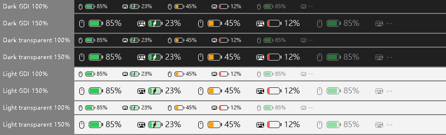
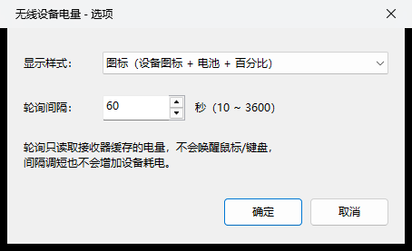

# WirelessBattery — 2.4G mouse & keyboard battery for TrafficMonitor

A [TrafficMonitor](https://github.com/zhongyang219/TrafficMonitor) plugin that shows the battery level of
2.4 GHz wireless mice and keyboards right on the Windows taskbar.



- **No extra drain on your devices.** The plugin only asks the USB receiver for the value it already caches.
  The mouse/keyboard radio is never woken up, so polling costs the peripheral nothing.
- **Never blocks TrafficMonitor.** All USB I/O runs on one low-priority background thread with hard timeouts.
- **Read-only.** Only *read* commands are sent. Nothing on the device is ever written or changed.
- Icon or text style, charging indicator, dimmed last value while the device sleeps, low-battery notification,
  hides the battery when no receiver is plugged in.
- Plugin-agnostic protocol layer: adding a new receiver is one source file plus one line in a table.
  **Contributions for more devices are very welcome.** See [Add your own device](#add-your-own-device).

> The plugin UI text is Chinese, like most of TrafficMonitor's audience. English translations are welcome.

## Supported devices

| Status | Brand / model | Receiver VID:PID | Protocol id |
|:---:|---|---|---|
| ✅ | VGN DragonFly F1 SE (mouse) | `3554:FB50` | `compx-mouse` |
| ✅ | MCHOSE K99 V3 (keyboard) | `3837:3033` | `mchose-glw-keyboard` |
| 🟡 | Pulsar X2 V2 Mini (mouse) | `3554:F508` | `compx-mouse` |
| 🟡 | Other mice on a Compx receiver (VID `3554` with a 17-byte `FF02` collection) | `3554:*` | `compx-mouse` |

✅ tested on real hardware 🟡 same protocol according to public documentation, not yet confirmed. Please
[report](https://github.com/Heisenberg1159/TrafficMonitor-2.4G-Wireless-Battery/issues/new?template=new_device.md) whether it works.

### Help wanted: protocols that are documented but not implemented yet

These are publicly documented by other open-source projects. Each one is a good first PR if you own the device.

| Brand / family | Receiver | What is known | Source |
|---|---|---|---|
| Logitech Lightspeed (e.g. G304) | `046D:C53F` | HID++ 2.0 long report `0x11`, features `0x1000` / `0x1001` / `0x1004` | [2.4G-battery-viewer] |
| ASUS ROG mice (Keris, Gladius, Harpe…) | `0B05:*` | 65-byte output report, command `0x0712` | [2.4G-battery-viewer] |
| Rapoo | `24AE:185A` | Collection `FF00/0002`, receiver broadcasts a 7-byte status every 3 s | [2.4G-battery-viewer] |
| MCHOSE keyboards on M HUB (G87 V2, G75 V2, G98 V3, Ace, Jet, Zero…) | `3837:*`, `41E4:*` | Report `77`, command `0x0904` | [2.4G-battery-viewer] |
| MCHOSE G87 (2.4G) | `41E4:2001` | Collection `FF04`, 20-byte output report `0x13` | [kmizmal/mchose-battery] |
| MCHOSE A7 V2 Ultra+ | `3837:100B` | Collection `FF01`, 81-byte feature report | [Tensyd/mchose-battery] |
| MCHOSE V9 PRO | `291D:385D` | Collection `FF90`, 64-byte output report | [Tensyd/mchose-battery] |
| MCHOSE V7 mouse | `3837:1016` | Vendor collection, see source | [kmizmal/mchose-battery] |

Your device is not listed? It most likely still can be added. Follow the guide below.

## Install

1. Download `WirelessBattery.dll` from [Releases](https://github.com/Heisenberg1159/TrafficMonitor-2.4G-Wireless-Battery/releases), or [build it](#build).
2. Exit TrafficMonitor and copy the DLL into `TrafficMonitor\plugins\`. The DLL is x64. It is tested with
   TrafficMonitor V1.86 x64.
3. Start TrafficMonitor. Open *Display settings* and enable the **鼠标电量 (mouse)** and/or
   **键盘电量 (keyboard)** items for the taskbar or main window.

Hover the item for details (device name, voltage, last reading time). Double-click it to refresh immediately.

## Configuration

Right-click the item → **Options** (or *Plugin manager* → *Options*):



Everything is stored in `WirelessBattery.ini` in TrafficMonitor's plugin config folder. The context menu entry
*打开电量插件配置文件* opens it. After a manual edit, use *立即刷新电量* (refresh) to apply it.

| Key | Default | Meaning |
|---|---|---|
| `display_style` | `icon` | `icon` = device glyph + battery + percentage, `text` = label + percentage |
| `poll_interval_sec` | `60` | 10–3600 s. Polling reads the receiver cache only, so short intervals are fine. |
| `low_battery_warn` | `20` | Notify once when the level drops to this %, `0` = off |
| `charging_mark` | `⚡` | Appended to the value in text style while charging |
| `sleep_mark` | *(empty)* | Appended to the last known value while the device sleeps |
| `debug_log` | `0` | `1` = log every poll (state, protocol, raw bytes) to `WirelessBattery.log` |

## How it works

```
TrafficMonitor UI thread ── DataRequired() ──► copies latest snapshot (never blocks)
                                                        ▲
background thread (below-normal priority) ─ every N s ─┘
   └─ for each device kind: try every registered protocol, stick to the one whose receiver is present
        └─ open the receiver's vendor HID collection ─► send READ request ─► wait ≤300 ms for the reply
             (receiver answers from its own cache; the radio link to the mouse/keyboard is not used)
```

Normal mouse-move / key-press reports carry no battery information, and these receivers do not expose the
standard HID battery usage. That is why each receiver family needs its own small protocol driver in
[`src/protocols/`](src/protocols).

## Add your own device

You do not need to touch the plugin, UI or threading code. A device is supported by one **provider**: a class
with three methods.

```cpp
USHORT VendorId() const;                             // receiver USB vendor id
bool   Matches(const HidInterfaceInfo& info) const;  // pick the vendor collection (usage page / report sizes)
BatteryReading Query(HidConnection& conn);           // send a read request, parse level / charging
```

The short version:

1. **Find the receiver's interfaces:** run `WirelessBatteryCli.exe --list`. It only reads descriptors and sends
   nothing. Collections marked `*` (vendor usage page `0xFFxx`) are the candidates.
2. **Find the protocol:** check the projects linked above first. Otherwise capture the vendor app with
   USBPcap + Wireshark while it shows the battery, and spot the request/reply pair and the battery byte.
3. **Check it does not wake the device:** with the device asleep, the reply must arrive in a few ms from the
   receiver cache.
4. **Implement:** copy a file in `src/protocols/`, add one row to [`registry.cpp`](src/protocols/registry.cpp),
   add the file to `CMakeLists.txt`.
5. **Test** with `WirelessBatteryCli.exe 10 2` (online, asleep, charging, unplug/replug), then open a PR.

📖 Full step-by-step guide with a code template and capture tips: **[docs/ADDING_A_DEVICE.md](docs/ADDING_A_DEVICE.md)**

🤖 Prefer to let an AI coding assistant do it? Paste **[docs/AI_PROMPT.md](docs/AI_PROMPT.md)** into Claude Code,
Copilot, Cursor or similar with this repo open. It walks you through collecting the data, then writes and tests
the provider.

## Build

Requirements: Visual Studio 2022 or newer with the *Desktop development with C++* workload. Its bundled CMake
and Ninja are used.

```bat
build.bat                                    :: -> build\WirelessBattery.dll, WirelessBatteryCli.exe
build.bat install "D:\TrafficMonitor"        :: build and copy the DLL into <dir>\plugins
```

Outputs in `build\`:

| File | Purpose |
|---|---|
| `WirelessBattery.dll` | The plugin |
| `WirelessBatteryCli.exe` | Reads batteries from the console, lists HID collections (`--list`) and protocols (`--protocols`) |
| `PluginHostTest.exe` | Loads the DLL like TrafficMonitor does: `PluginHostTest.exe build\WirelessBattery.dll 10 <configDir>` |
| `RenderPreview.exe` | Renders all item states to a PNG for UI review |

## Contributing

PRs are welcome, especially new devices. See [CONTRIBUTING.md](CONTRIBUTING.md). Please always include the
`WirelessBatteryCli` output from real hardware.

## Credits

Protocol knowledge comes from these open-source projects. Thank you!

- [andrewrabert/python-pulsar-mouse-tool][pulsar]: Compx mouse protocol (Pulsar)
- [HHHHHH233333/2.4G-battery-viewer][2.4G-battery-viewer]: Logitech, ASUS ROG, Rapoo, MCHOSE M HUB notes
- [kmizmal/mchose-battery]: MCHOSE G87 / V7 / V9 protocols
- [Tensyd/mchose-battery]: MCHOSE compatibility table
- [TrafficMonitor](https://github.com/zhongyang219/TrafficMonitor) by zhongyang219: the host application and plugin API

No code from these projects is included. This plugin is an independent C++ implementation.

## License

[MIT](LICENSE) © 2026 [Heisenberg1159](https://github.com/Heisenberg1159) and contributors. `src/PluginInterface.h` is part of TrafficMonitor and is distributed under its own license.
See [THIRD_PARTY_NOTICES.md](THIRD_PARTY_NOTICES.md).

This is an unofficial project, not affiliated with or endorsed by VGN, MCHOSE, Compx, Pulsar or any other vendor.
All product names and trademarks belong to their owners.

[pulsar]: https://github.com/andrewrabert/python-pulsar-mouse-tool
[2.4G-battery-viewer]: https://github.com/HHHHHH233333/2.4G-battery-viewer
[kmizmal/mchose-battery]: https://github.com/kmizmal/mchose-battery
[Tensyd/mchose-battery]: https://github.com/Tensyd/mchose-battery
