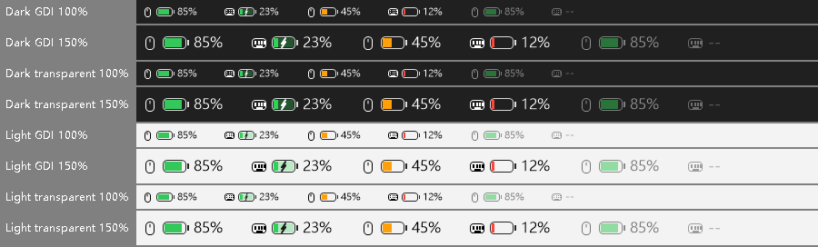
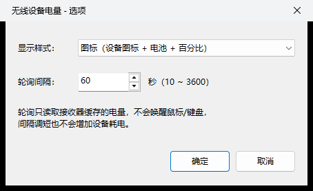

# WirelessBattery — 把 2.4G 鼠标/键盘电量放上 Windows 任务栏

[TrafficMonitor](https://github.com/zhongyang219/TrafficMonitor) 插件：在 Windows 任务栏直接显示
2.4 GHz 无线鼠标和键盘的电量。（英文原文见 [README.en.md](README.en.md)）



- **不额外消耗设备电量。** 插件只向 USB 接收器询问它已缓存的数值，
  不会唤醒鼠标/键盘的无线电，轮询对外设零成本。
- **绝不阻塞 TrafficMonitor。** 所有 USB I/O 跑在一条低优先级后台线程上，带硬超时。
- **只读。** 只发送*读*命令，绝不写入或修改设备上的任何东西。
- 图标或文字样式、充电标记、设备休眠时旧值变暗、低电量通知、
  没插接收器时隐藏电量显示。
- 与插件无关的协议层：新增一种接收器 = 一个源文件 + 表里一行。
  **非常欢迎贡献更多设备。** 见[添加你自己的设备](#添加你自己的设备)。

> 插件界面文字为中文（TrafficMonitor 的用户群以中文为主）。欢迎英文翻译。

## 支持的设备

| 状态 | 品牌 / 型号 | 接收器 VID:PID | 协议 id |
|:---:|---|---|---|
| ✅ | VGN DragonFly F1 SE（鼠标） | `3554:FB50` | `compx-mouse` |
| ✅ | 罗技 G304 LIGHTSPEED（鼠标） | `046D:C53F` | `logitech-lightspeed-mouse` |
| ✅ | MCHOSE K99 V3（键盘） | `3837:3033` | `mchose-glw-keyboard` |
| 🟡 | Pulsar X2 V2 Mini（鼠标） | `3554:F508` | `compx-mouse` |
| 🟡 | Compx 接收器上的其他鼠标（VID `3554`、17 字节 `FF02` collection） | `3554:*` | `compx-mouse` |

✅ 真机实测 🟡 按公开文档判断同协议、尚未确认。请[反馈](https://github.com/Heisenberg1159/TrafficMonitor-2.4G-Wireless-Battery/issues/new?template=new_device.md)是否可用。

### 招募：已有公开文档但尚未实现的协议

以下协议由其他开源项目公开记录。手里有对应设备的话，每一条都是很好的第一个 PR。

| 品牌 / 系列 | 接收器 | 已知信息 | 来源 |
|---|---|---|---|
| 华硕 ROG 鼠标（Keris、Gladius、Harpe…） | `0B05:*` | 65 字节 output report，命令 `0x0712` | [2.4G-battery-viewer] |
| 雷柏 | `24AE:185A` | Collection `FF00/0002`，接收器每 3 秒广播 7 字节状态 | [2.4G-battery-viewer] |
| M HUB 上的迈从键盘（G87 V2、G75 V2、G98 V3、Ace、Jet、Zero…） | `3837:*`、`41E4:*` | Report `77`，命令 `0x0904` | [2.4G-battery-viewer] |
| 迈从 G87（2.4G） | `41E4:2001` | Collection `FF04`，20 字节 output report `0x13` | [kmizmal/mchose-battery] |
| 迈从 A7 V2 Ultra+ | `3837:100B` | Collection `FF01`，81 字节 feature report | [Tensyd/mchose-battery] |
| 迈从 V9 PRO | `291D:385D` | Collection `FF90`，64 字节 output report | [Tensyd/mchose-battery] |
| 迈从 V7 鼠标 | `3837:1016` | 厂商 collection，见源码 | [kmizmal/mchose-battery] |

你的设备不在表里？大概率仍然可以加。按下面的指南做。

## 安装

1. 从 [Releases](https://github.com/Heisenberg1159/TrafficMonitor-2.4G-Wireless-Battery/releases) 下载 `WirelessBattery.dll`，或[自己编译](#编译)。
2. 退出 TrafficMonitor，把 DLL 复制进 `TrafficMonitor\plugins\`。DLL 为 x64，
   在 TrafficMonitor V1.86 x64 上测试。
3. 启动 TrafficMonitor，打开*显示设置*，为任务栏或主窗口勾选
   **鼠标电量** 和/或 **键盘电量** 项目。

悬停项目查看详情（设备名、电压、上次读取时间）。双击立即刷新。

## 配置

右键项目 → **选项**（或*插件管理* → *选项*）：



所有设置保存在 TrafficMonitor 插件配置目录的 `WirelessBattery.ini`。右键菜单
*打开电量插件配置文件* 可直接打开它。手动编辑后，用*立即刷新电量*（刷新）生效。

| 键 | 默认值 | 含义 |
|---|---|---|
| `display_style` | `icon` | `icon` = 设备图标 + 电池 + 百分比，`text` = 标签 + 百分比 |
| `poll_interval_sec` | `60` | 10–3600 秒。轮询只读接收器缓存，短间隔也无妨。无读数时（接收器不在位/设备休眠）内置 3 秒快重试。 |
| `low_battery_warn` | `20` | 电量降到该百分比时通知一次，`0` = 关闭 |
| `charging_mark` | `⚡` | 文字样式下充电时追加在数值后 |
| `sleep_mark` | *（空）* | 设备休眠时追加在上次已知数值后 |
| `debug_log` | `0` | `1` = 把每次轮询（状态、协议、原始字节）记入 `WirelessBattery.log` |

## 工作原理

```
TrafficMonitor UI 线程 ── DataRequired() ──► 复制最新快照（绝不阻塞）
                                                        ▲
后台线程（低于正常优先级）─ 每 N 秒 ─┘
   └─ 对每种设备：尝试所有已注册协议，固定使用接收器在位的那一个
        └─ 打开接收器的厂商 HID collection ─► 发读请求 ─► 等回复 ≤300 ms
             （接收器用自己的缓存应答；不使用通往鼠标/键盘的无线电链路）
```

普通鼠标移动/按键报告不携带电量信息，这些接收器也不暴露标准 HID 电池 usage。
所以每个接收器家族都需要 [`src/protocols/`](src/protocols) 里一个自己的小协议驱动。

罗技 Lightspeed 例外说明：HID++ 电量特征由鼠标自身应答（醒着时经无线电，约 10–30 ms/请求）；
鼠标休眠时接收器直接忽略/拒绝请求，不会唤醒设备。G304 使用 AA 电池，百分比直接采用
`0x1000` 上报值，不做电压曲线估算；该型号不上报电压与充电状态。

## 添加你自己的设备

不需要碰插件、UI 或线程代码。一个设备由一个 **provider** 支持：三个方法的类。

```cpp
USHORT VendorId() const;                             // 接收器 USB vendor id
bool   Matches(const HidInterfaceInfo& info) const;  // 挑选厂商 collection（usage page / 报告长度）
BatteryReading Query(HidConnection& conn);           // 发读请求，解析电量 / 充电状态
```

简版流程：

1. **找接收器接口：** 运行 `WirelessBatteryCli.exe --list`。只读描述符、不发任何数据。
   带 `*` 的 collection（厂商 usage page `0xFFxx`）是候选。
2. **找协议：** 先查上面链接的项目。否则用 USBPcap + Wireshark 抓厂商软件显示电量时的包，
   找出请求/回复对和电量字节。
3. **确认不唤醒设备：** 设备休眠时，回复必须在几 ms 内来自接收器缓存。
4. **实现：** 复制 `src/protocols/` 里一个文件，在 [`registry.cpp`](src/protocols/registry.cpp) 加一行，
   把文件加进 `CMakeLists.txt`。
5. **测试：** `WirelessBatteryCli.exe 10 2`（在线、休眠、充电、拔插），然后开 PR。

📖 带代码模板和抓包技巧的完整分步指南：**[docs/ADDING_A_DEVICE.md](docs/ADDING_A_DEVICE.md)**

🤖 想让 AI 编程助手来做？把 **[docs/AI_PROMPT.md](docs/AI_PROMPT.md)** 贴给 Claude Code、
Copilot、Cursor 等并打开本仓库。它会带你收集数据、然后写并测试 provider。

## 编译

要求：Visual Studio 2022 或更新，带*使用 C++ 的桌面开发*工作负载。使用其自带的 CMake 和 Ninja。

```bat
build.bat                                    :: -> build\WirelessBattery.dll, WirelessBatteryCli.exe
build.bat install "D:\TrafficMonitor"        :: 编译并把 DLL 复制进 <dir>\plugins
```

`build\` 中的产物：

| 文件 | 用途 |
|---|---|
| `WirelessBattery.dll` | 插件本体 |
| `WirelessBatteryCli.exe` | 控制台读电量；列 HID collection（`--list`）和协议（`--protocols`） |
| `PluginHostTest.exe` | 像 TrafficMonitor 一样加载 DLL：`PluginHostTest.exe build\WirelessBattery.dll 10 <configDir>` |
| `RenderPreview.exe` | 把所有项目状态渲染成 PNG 供 UI 审查 |

## 贡献

欢迎 PR，尤其是新设备。见 [CONTRIBUTING.md](CONTRIBUTING.md)。请务必附上真机的
`WirelessBatteryCli` 输出。

## 致谢

协议知识来自以下开源项目，感谢！

- [andrewrabert/python-pulsar-mouse-tool][pulsar]：Compx 鼠标协议（Pulsar）
- [HHHHHH233333/2.4G-battery-viewer][2.4G-battery-viewer]：罗技、华硕 ROG、雷柏、迈从 M HUB 笔记
- [kmizmal/mchose-battery]：迈从 G87 / V7 / V9 协议
- [Tensyd/mchose-battery]：迈从兼容表
- [TrafficMonitor](https://github.com/zhongyang219/TrafficMonitor) 作者 zhongyang219：主程序与插件 API

未包含这些项目的代码。本插件是独立的 C++ 实现。

## 许可证

[MIT](LICENSE) © 2026 [Heisenberg1159](https://github.com/Heisenberg1159) 及贡献者。`src/PluginInterface.h` 属于 TrafficMonitor，按其自身许可证分发。
见 [THIRD_PARTY_NOTICES.md](THIRD_PARTY_NOTICES.md)。

本项目为非官方项目，与 VGN、MCHOSE、Compx、Pulsar、罗技等任何厂商无关联、未获其背书。
所有产品名与商标归其所有者。

[pulsar]: https://github.com/andrewrabert/python-pulsar-mouse-tool
[2.4G-battery-viewer]: https://github.com/HHHHHH233333/2.4G-battery-viewer
[kmizmal/mchose-battery]: https://github.com/kmizmal/mchose-battery
[Tensyd/mchose-battery]: https://github.com/Tensyd/mchose-battery